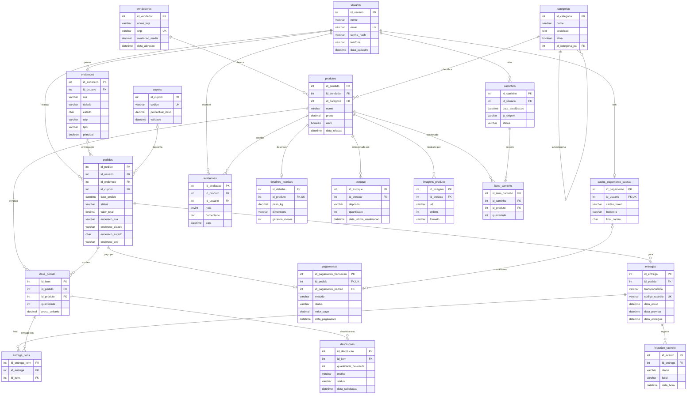
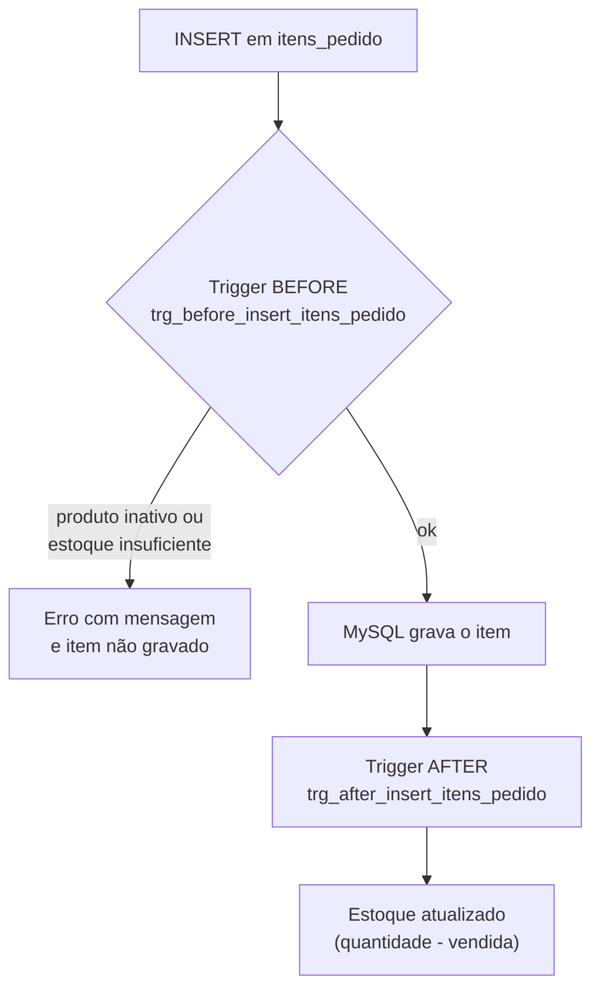

<div align="center">

# 🛒 Amazon Marketplace - Banco de Dados

**Banco de dados relacional em MySQL para um marketplace online: usuários, vendedores, catálogo, estoque, carrinho, pedidos, pagamentos, entregas, avaliações e devoluções.**


Modelagem lógica no **MySQL Workbench** e implementação completa em **SQL**

[Sobre](#-sobre-o-projeto) •
[Funcionalidades](#-funcionalidades) •
[Tecnologias](#-tecnologias) •
[Modelo lógico](#-modelo-lógico) •
[Recursos do banco](#-recursos-do-banco) •
[Como executar](#-como-executar) •
[Estrutura](#-estrutura-do-repositório)

</div>

---

## 📌 Sobre o projeto

Um marketplace precisa registrar **quem compra, quem vende, o que está à venda, quanto há em estoque, como o pedido foi pago e onde a encomenda está**. Este projeto reúne o banco de dados que sustenta esse fluxo, inspirado no modelo da Amazon, com **20 tabelas** relacionadas por chaves primárias e estrangeiras.

- **Compra:** o usuário monta um **carrinho**, aplica um **cupom**, fecha o **pedido** e realiza o **pagamento** por cartão, Pix ou boleto.
- **Catálogo:** **vendedores** oferecem **produtos** organizados em **categorias** hierárquicas, com detalhes técnicos, imagens e **estoque por depósito**.
- **Entrega:** cada pedido gera uma ou mais **entregas**, com código de rastreio e **histórico de eventos**. Pedidos com vários itens podem ser enviados em remessas separadas.
- **Pós-venda:** **avaliações** de produtos (nota de 1 a 5) e **devoluções** de itens, com acompanhamento de status.
- **Automação no banco:** **triggers** validam a inclusão de itens no pedido e baixam o estoque automaticamente.

---

## ✨ Funcionalidades

| | Funcionalidade | Descrição | Status |
|---|---|---|---|
| 🗂️ | **Estrutura** | 20 tabelas com chaves primárias, estrangeiras, `UNIQUE` e `CHECK` | ✅ |
| 🌱 | **Carga de dados** | dados fictícios e coerentes, com no mínimo 30 `INSERT` em cada tabela | ✅ |
| 👁️ | **Views** | 3 visões prontas: pedidos detalhados, catálogo com estoque e vendas por vendedor | ✅ |
| ⚙️ | **Triggers** | 1 `BEFORE INSERT` (validação) e 1 `AFTER INSERT` (baixa de estoque) | ✅ |
| 🔐 | **Usuários e permissões** | 3 usuários com níveis distintos, `GRANT`, `REVOKE` e `DROP USER` | ✅ |
| 🔄 | **Transações** | exemplos de `COMMIT`, `ROLLBACK` e `SAVEPOINT` | ✅ |
| ⚡ | **Índices** | índice em atributo de consulta frequente, com justificativa de desempenho | 🚧 |
| 🛠️ | **Scripts de manutenção** | exemplos de `DROP`, `ALTER`, `UPDATE` e `DELETE` | 🚧 |
| 🔎 | **Consultas** | `SELECT` com `INNER JOIN`, `LEFT JOIN`, `RIGHT JOIN`, `GROUP BY`, `HAVING` e `ORDER BY` | 🚧 |

---

## 🛠️ Tecnologias

| Camada | Tecnologia |
|---|---|
| Banco de dados | MySQL 8 (mínimo 8.0.16, necessário para aplicar as cláusulas `CHECK`) |
| Modelagem | MySQL Workbench (diagrama EER em `.mwb`) |
| Linguagem | SQL (DDL, DML, DCL e controle de transação) |
| Versionamento | Git e GitHub |

---

## 🧩 Modelo lógico

### Como visualizar

1. Instalar o [MySQL Workbench](https://www.mysql.com/products/workbench/).
2. Abrir o Workbench e acessar **File > Open Model...**.
3. Selecionar o arquivo [`Modelo_logico_amazon.mwb`](amazon-marketplace/Modelo_logico_amazon.mwb).
4. Na aba **Model**, dar duplo clique em **EER Diagram** para abrir o diagrama com tabelas e relacionamentos.

O diagrama abaixo resume o mesmo modelo e é exibido diretamente no GitHub.



### Módulos do banco

| Módulo | Tabelas | Função |
|---|---|---|
| **Usuários e pagamento** | `usuarios`, `enderecos`, `dados_pagamento_padrao` | cadastro dos clientes, endereços de entrega ou cobrança e cartão padrão (guardado como token) |
| **Catálogo** | `vendedores`, `categorias`, `produtos`, `detalhes_tecnicos`, `estoque`, `imagens_produto` | lojas parceiras, categorias hierárquicas, produtos, especificações, saldo por depósito e imagens |
| **Compra** | `carrinhos`, `itens_carrinho`, `cupons`, `pedidos`, `itens_pedido`, `pagamentos` | carrinho, desconto, pedido com seus itens e transação de pagamento |
| **Entrega e pós-venda** | `entregas`, `entrega_itens`, `historico_rastreio`, `avaliacoes`, `devolucoes` | envio, rastreamento, avaliação dos produtos e devolução de itens |

### Decisões de modelagem

- **Histórico de preço:** `itens_pedido.preco_unitario` guarda o valor cobrado na data da compra, sem sofrer alteração caso o preço do produto mude depois.
- **Cópia do endereço no pedido:** `pedidos` armazena rua, cidade, estado e CEP, além da referência a `enderecos`. Se o endereço for excluído, `id_endereco` passa a `NULL` (`ON DELETE SET NULL`) e o pedido mantém o local de entrega.
- **Entregas parciais:** a tabela `entrega_itens` resolve a relação **N:N** entre entregas e itens, permitindo dividir um pedido em várias remessas.
- **Categorias hierárquicas:** `categorias.id_categoria_pai` é um auto-relacionamento, que permite subcategorias.
- **Dados sensíveis protegidos:** senha em hash (`senha_hash`) e cartão em token (`cartao_token`), sem texto puro.
- **Integridade:** `CHECK` para valores válidos (status, notas, preços e quantidades) e `UNIQUE` para evitar duplicidades, como o mesmo produto repetido no carrinho, uma avaliação por usuário e produto ou dois itens com a mesma ordem de imagem.

---

## ⚙️ Recursos do banco

### 👁️ Views

| View | Tabelas envolvidas | Para que serve |
|---|---|---|
| `vw_pedidos_detalhados` | `pedidos`, `usuarios`, `cupons` | lista cliente, status, valor e cupom aplicado de cada pedido |
| `vw_catalogo_estoque` | `produtos`, `vendedores`, `categorias`, `estoque` | mostra produto, loja, categoria, depósito e quantidade disponível |
| `vw_vendas_por_vendedor` | `vendedores`, `produtos`, `itens_pedido`, `pedidos` | soma pedidos, unidades e faturamento por loja, ignorando pedidos cancelados |

```sql
SELECT nome_loja, total_pedidos, unidades_vendidas, faturamento_bruto
FROM vw_vendas_por_vendedor
ORDER BY faturamento_bruto DESC
LIMIT 10;
```

### ⚙️ Triggers

Os dois triggers atuam na inclusão de itens em um pedido (`itens_pedido`).

| Trigger | Momento | O que faz |
|---|---|---|
| `trg_before_insert_itens_pedido` | `BEFORE INSERT` | recusa produto inativo e quantidade maior que o estoque disponível |
| `trg_after_insert_itens_pedido` | `AFTER INSERT` | baixa a quantidade vendida do estoque, no depósito com maior saldo |



Mensagens retornadas pelo trigger `BEFORE`:

| Situação | Mensagem |
|---|---|
| Produto com `ativo = FALSE` | `Produto inativo: nao pode ser adicionado ao pedido` |
| Quantidade acima do saldo de qualquer depósito | `Estoque insuficiente para a quantidade solicitada` |

### 🔐 Usuários e permissões

| Usuário | Permissões concedidas | Após a revogação |
|---|---|---|
| `usuario_leitura` | `SELECT` | usuário **excluído** com `DROP USER` |
| `usuario_operador` | `SELECT`, `INSERT`, `UPDATE` | perde `UPDATE` (fica com `SELECT` e `INSERT`) |
| `usuario_admin` | `ALL PRIVILEGES` | perde `DROP` (mantém os demais privilégios) |

> As permissões são conferidas com `SHOW GRANTS FOR 'usuario'@'localhost'`. A criação de usuários exige uma conta administrativa, como o `root`.

### 🔄 Transações

| Exemplo | Comandos | Resultado |
|---|---|---|
| Reposição de estoque | `START TRANSACTION` → `UPDATE` → `COMMIT` | a alteração é confirmada e permanece |
| Correção de erro | `START TRANSACTION` → `UPDATE` com preço zerado → `ROLLBACK` | os preços voltam ao valor original |
| Desfazer parte | `SAVEPOINT` → segundo `UPDATE` → `ROLLBACK TO SAVEPOINT` → `COMMIT` | só a primeira alteração é mantida |
| Teste dos triggers | pedido e item dentro de uma transação → `ROLLBACK` | o estoque baixa durante a transação e volta ao final |

---

## 🌱 Dados de demonstração

O arquivo [`inserts.sql`](amazon-marketplace/inserts.sql) popula todas as tabelas com dados fictícios, em ordem compatível com as chaves estrangeiras:

- **30 usuários** de diferentes cidades, com endereços, cartões padrão e carrinhos;
- **30 vendedores** com CNPJ válido e **30 produtos** distribuídos em **30 categorias** (8 principais e 22 subcategorias);
- **estoque por depósito**, imagens, detalhes técnicos e **30 cupons** (vencidos e válidos);
- **30 pedidos** nos status `entregue`, `enviado`, `pago`, `cancelado` e `processando`, com 48 itens;
- pagamentos por `cartao`, `pix` e `boleto`, nos status `aprovado`, `recusado` e `estornado`;
- **34 entregas** (incluindo remessas parciais), **84 eventos de rastreio**, **30 avaliações** e **30 devoluções**;
- pedidos sem endereço cadastrado (`id_endereco` nulo) e produtos inativos, úteis para testar `LEFT JOIN` e as regras dos triggers.

No total são **699 comandos `INSERT`**, com tabelas e colunas em minúsculo e comandos SQL em maiúsculo.

---

## 🚀 Como executar

### Pré-requisitos

- [MySQL 8.0.16 ou superior](https://dev.mysql.com/downloads/mysql/)
- [MySQL Workbench](https://www.mysql.com/products/workbench/)
- Acesso a uma conta administrativa (`root`) para criar usuários e permissões

### Ordem de execução

Os arquivos devem ser executados **nesta ordem**:

| # | Arquivo | Conteúdo |
|---|---|---|
| 1 | [`atividade_amazon.sql`](amazon-marketplace/atividade_amazon.sql) | cria o banco `amazon_marketplace` e as 20 tabelas |
| 2 | [`inserts.sql`](amazon-marketplace/inserts.sql) | carga de dados |
| 3 | [`views.sql`](amazon-marketplace/views.sql) | 3 views |
| 4 | [`triggers.sql`](amazon-marketplace/triggers.sql) | 2 triggers e teste em transação |
| 5 | [`usuarios.sql`](amazon-marketplace/usuarios.sql) | criação de 3 usuários |
| 6 | [`permissoes.sql`](amazon-marketplace/permissoes.sql) | `GRANT`, `REVOKE` e `DROP USER` |
| 7 | [`transacao.sql`](amazon-marketplace/transacao.sql) | `COMMIT`, `ROLLBACK` e `SAVEPOINT` |

> ⚠️ O `atividade_amazon.sql` começa com `DROP DATABASE IF EXISTS amazon_marketplace;`. Se o banco já existir, todo o conteúdo será apagado e recriado.

> ⚠️ Os triggers devem ser criados **depois** da carga de dados, para que os 699 `INSERT` não disparem a validação e a baixa de estoque. O `usuarios.sql` precisa rodar antes do `permissoes.sql`, pois os usuários devem existir para receber permissões.

### Pelo MySQL Workbench

1. Conectar a uma instância local do MySQL.
2. Acessar **File > Open SQL Script...** e abrir o primeiro arquivo da tabela.
3. Executar o script completo (ícone de raio).
4. Repetir os passos 2 e 3 para cada arquivo, seguindo a ordem.

### Pelo terminal

Dentro da pasta `amazon-marketplace`:

```bash
mysql -u root -p
```

```sql
SOURCE atividade_amazon.sql;
SOURCE inserts.sql;
SOURCE views.sql;
SOURCE triggers.sql;
SOURCE usuarios.sql;
SOURCE permissoes.sql;
SOURCE transacao.sql;
```

### Conferindo o resultado

```sql
USE amazon_marketplace;

SHOW TABLES;                          -- 20 tabelas e 3 views
SHOW TRIGGERS;                        -- 2 triggers
SELECT COUNT(*) FROM pedidos;         -- 30 pedidos
SHOW GRANTS FOR 'usuario_operador'@'localhost';
```

---

## 📁 Estrutura do repositório

```
Projeto-LBD/
├── 📄 README.md                        # documentação do projeto
└── 📂 amazon-marketplace/
    ├── Modelo_logico_amazon.mwb        # modelo lógico (MySQL Workbench)
    ├── atividade_amazon.sql            # banco e 20 tabelas
    ├── inserts.sql                     # carga de dados (699 INSERTs)
    ├── views.sql                       # 3 views
    ├── triggers.sql                    # trigger BEFORE e AFTER
    ├── usuarios.sql                    # criação de 3 usuários
    ├── permissoes.sql                  # GRANT, REVOKE e DROP USER
    └── transacao.sql                   # COMMIT, ROLLBACK e SAVEPOINT
```

---

## 🗺️ Roadmap

- [X] **Fase 1 (Modelagem):** modelo lógico no MySQL Workbench
- [X] **Fase 2 (Estrutura):** banco e 20 tabelas com chaves e restrições
- [X] **Fase 3 (Dados):** carga com no mínimo 30 registros por tabela
- [X] **Fase 4 (Recursos):** views, triggers, usuários, permissões e transações
- [ ] **Fase 5 (Desempenho):** índice com justificativa
- [ ] **Fase 6 (Manutenção):** scripts de exclusão, alteração e edição de registros
- [ ] **Fase 7 (Consultas):** `SELECT` com `JOIN`, agrupamentos e ordenação

---

## 👥 Equipe

| Nome | GitHub |
|---|---|
| Pedro de Araujo Freitas | [Pedr0-4raujo](https://github.com/Pedr0-4raujo) |

---

<div align="center">

Banco de dados relacional de um marketplace online, modelado e implementado em **MySQL**.

</div>